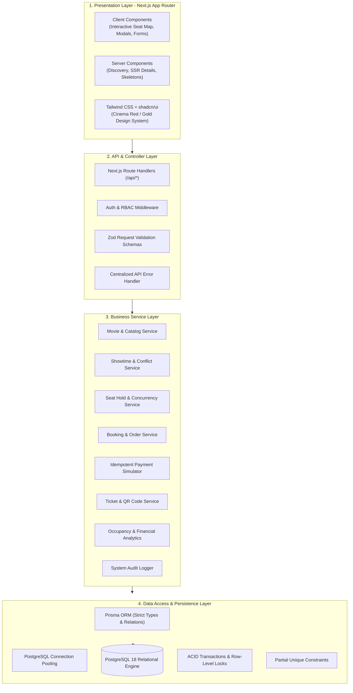
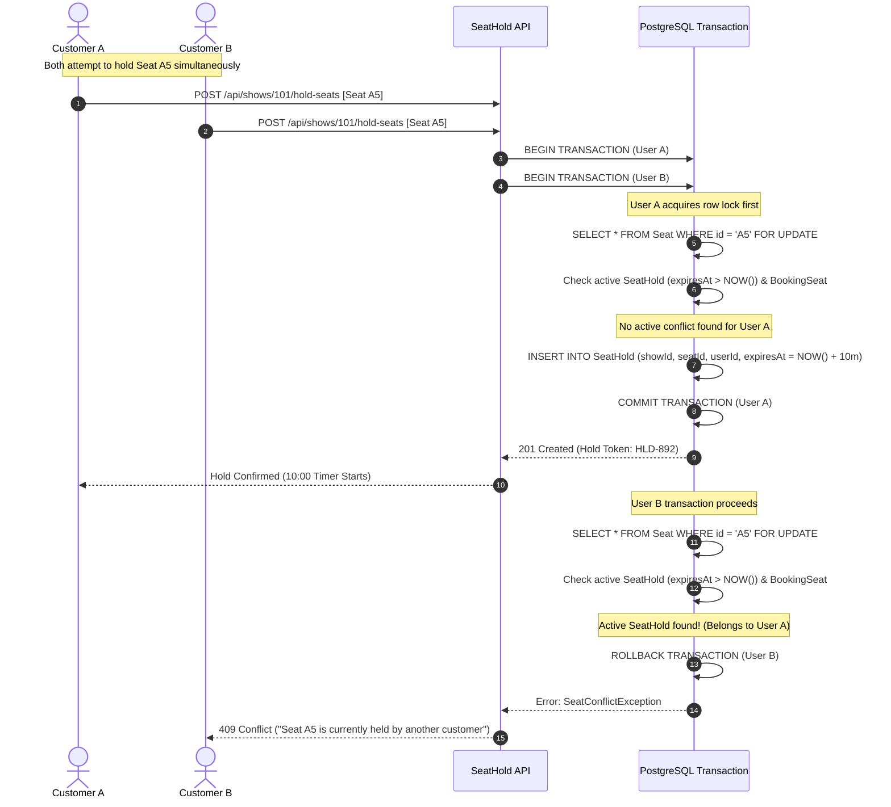
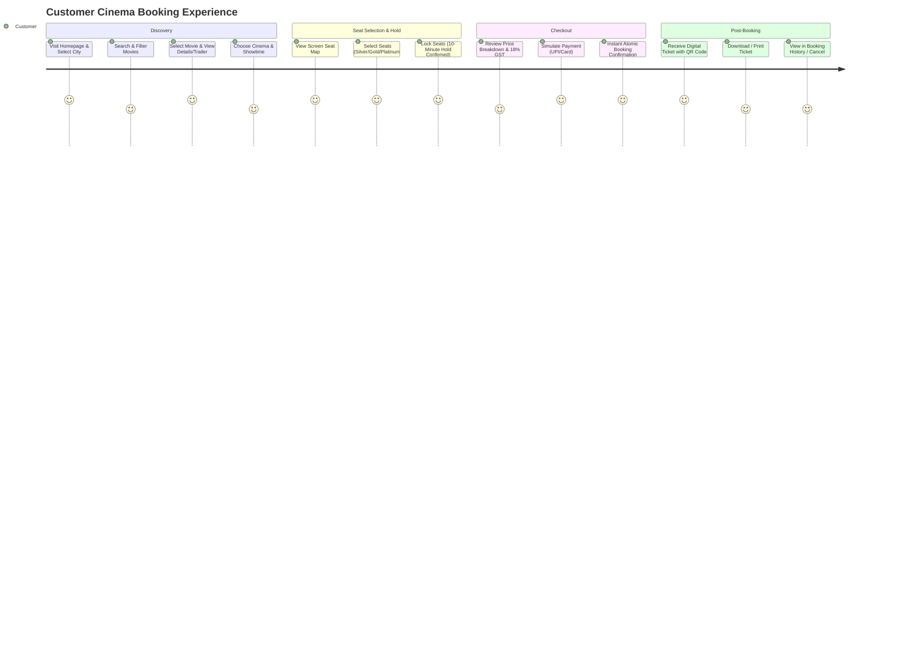
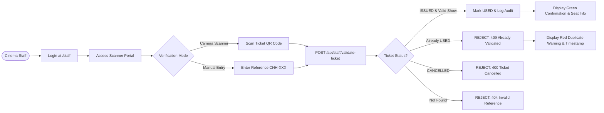
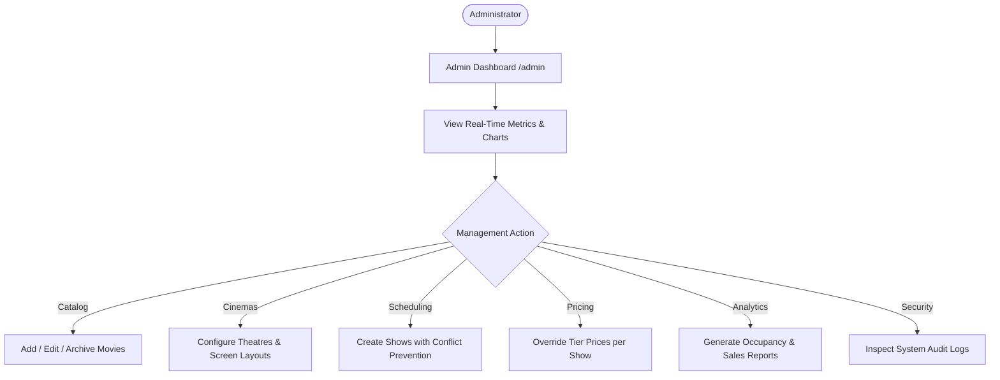
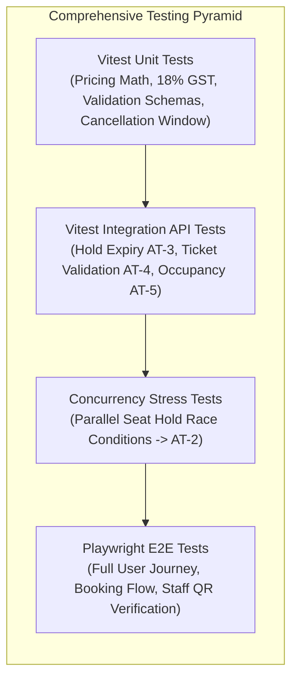

# CineHub — System Architecture & Technical Specifications

**Document Version:** 1.0.0 (Stage A — Planning & Architecture)  
**System:** CineHub Cinema Hall Ticket Booking System  
**Evaluation Standard:** ALGIONS AI LABS PRIVATE LIMITED Advanced Project Assessment  

---

## 1. System Overview & Architectural Paradigm

CineHub is architected as a **Modular Clean Monolith** running on Next.js 15 (App Router) and TypeScript in strict mode, backed by a relational PostgreSQL 18 database via Prisma ORM.

The monolithic architecture is chosen intentionally to eliminate network latency, serialization overhead, distributed transaction failures, and operational complexity associated with microservices, while enforcing strict domain separation and maintainability through a clean four-layer boundary:



### Architectural Layer Responsibilities

1. **Presentation Layer (`src/components/`, `src/app/`):**
   - React 19 Server Components for high-speed initial rendering, SEO optimization, and data streaming.
   - Interactive Client Components strictly where state is required (e.g., SVG cinema seat map, timer countdown, dynamic search filters).
   - Component UI built on headless Radix UI primitives via shadcn/ui, styled with a cinematic dark theme palette.

2. **API & Controller Layer (`src/app/api/`, `src/middleware.ts`):**
   - Edge Middleware enforcing path-based authentication and role authorization (`CUSTOMER`, `STAFF`, `ADMIN`).
   - Route Handlers executing input parsing and Zod schema validation before calling service methods.
   - Standardized JSON responses and unified error handling with appropriate HTTP status codes (200, 201, 400, 401, 403, 404, 409, 422, 500).

3. **Business Service Layer (`src/services/`):**
   - Pure, decoupled TypeScript services encapsulating domain business logic.
   - No direct HTTP object dependencies (`Request` or `Response`), ensuring 100% unit-testability without spinning up mock HTTP servers.
   - Manages transactional boundaries, hold duration calculations, tax/fee computation, and audit event dispatching.

4. **Persistence Layer (`prisma/`, `src/lib/prisma.ts`):**
   - Strongly-typed database access via Prisma Client.
   - PostgreSQL 18 executing row-level locks (`FOR UPDATE`), composite indexes, and database-level unique constraints.

---

## 2. Technology Stack & Technical Justification

| Layer / Concern | Technology Selection | Justification & Architectural Benefit |
|---|---|---|
| **Framework** | **Next.js 15 (App Router)** | Provides unified full-stack TypeScript execution, React Server Components for near-instant movie discovery page loads, Route Handlers for high-throughput REST APIs, and Edge Middleware for route guarding. |
| **Language** | **TypeScript (Strict Mode)** | Eliminates runtime type errors, guarantees schema alignment between Prisma database models and API payloads, and ensures maintainable enterprise-grade code. |
| **Styling & UI** | **Tailwind CSS + shadcn/ui** | Headless accessible components (Radix UI) styled with utility classes. Eliminates CSS bundle bloat, ensures consistent design tokens, and enables responsive mobile-first layouts. |
| **Icons** | **Lucide React** | Lightweight, tree-shakable SVG icon system matching modern web design standards without font icon rendering issues. |
| **Form Handling** | **React Hook Form + Zod** | Controlled, performant form state management with zero unnecessary re-renders; Zod schemas shared seamlessly across client forms and server Route Handlers. |
| **Database** | **PostgreSQL 18** | Industry-standard ACID relational database providing row-level locking (`SELECT ... FOR UPDATE`), transaction isolation, partial unique indexes, and robust datetime/interval math. |
| **ORM** | **Prisma ORM** | Type-safe query builder, declarative schema modeling, automated SQL migrations, and reliable connection pooling. |
| **Authentication** | **Auth.js (NextAuth v5)** | Battle-tested session management, JWT tokens in secure `HttpOnly` cookies, Credentials provider with bcrypt hashing, and server-side RBAC validation. |
| **Password Security**| **bcryptjs** | Proven cryptographic hashing algorithm with configurable salt rounds (12) resistant to rainbow table and brute-force attacks. |
| **QR Code Engine** | **qrcode** | Zero-dependency server-side generation of PNG/DataURL QR codes for digital tickets verifiable by any standard camera/scanner. |
| **Data Analytics** | **Recharts** | Declarative React charting library built on SVG for responsive administrative revenue graphs and theatre occupancy visualizations. |
| **Testing** | **Vitest + Playwright** | Vitest delivers sub-second unit and integration test execution with native TypeScript support; Playwright automates end-to-end browser user flows. |
| **API Docs** | **OpenAPI 3.0 / Swagger** | Interactive machine-readable API documentation enabling external verification and reviewer testing. |

---

## 3. Application Directory Structure

```
cineHUB/
├── .env.example                     # Environment variable blueprint (no secrets committed)
├── .gitignore                       # Git ignore configuration
├── package.json                     # Dependency manifests and run scripts
├── tsconfig.json                    # TypeScript strict mode configuration
├── tailwind.config.ts               # Custom design system palette and theme extensions
├── postcss.config.mjs               # PostCSS configuration
├── next.config.ts                   # Next.js runtime configuration
├── vitest.config.ts                 # Vitest test runner configuration
├── playwright.config.ts             # Playwright E2E configuration
├── prisma/
│   ├── schema.prisma                # Full 19-entity relational schema
│   ├── migrations/                  # Generated repeatable SQL migrations
│   └── seed.ts                      # Comprehensive Indian cinema demo dataset
├── docs/
│   ├── assignment_brief.docx        # Evaluator project assignment document
│   ├── PROJECT_PLAN.md              # 15-day implementation roadmap & scope
│   ├── ARCHITECTURE.md              # System architecture (this document)
│   ├── DATABASE_DESIGN.md           # Schema, relations, indexes & ER diagram
│   ├── API_DESIGN.md                # REST API specifications & OpenAPI schema
│   ├── REQUIREMENTS_TRACEABILITY.md # Traceability matrix for all criteria
│   ├── TECHNICAL_REPORT.md          # Stage B final submission technical report
│   └── DEMO_SCRIPT.md               # 3-5 minute video script & test checklist
├── src/
│   ├── middleware.ts                # Next.js Edge Auth & RBAC Route Guard
│   ├── app/                         # Next.js App Router (Pages & APIs)
│   │   ├── layout.tsx               # Root application layout with providers
│   │   ├── page.tsx                 # Public homepage (Hero, Now Showing, Cities)
│   │   ├── login/page.tsx           # Authentication: Login portal
│   │   ├── register/page.tsx        # Authentication: Customer registration
│   │   ├── movies/
│   │   │   ├── page.tsx             # Movie catalog with search & multi-filters
│   │   │   └── [slug]/page.tsx      # Movie details, synopsis, trailer, dates
│   │   ├── booking/
│   │   │   ├── [showId]/
│   │   │   │   ├── page.tsx         # Interactive Seat Selection Map
│   │   │   │   ├── summary/page.tsx # Booking Summary, GST breakdown, Timer
│   │   │   │   └── payment/page.tsx # Simulated Payment Gateway (UPI/Card)
│   │   │   └── ticket/[ref]/page.tsx# Digital Ticket with QR code & Print
│   │   ├── customer/
│   │   │   ├── bookings/page.tsx    # Customer booking history & cancellations
│   │   │   └── profile/page.tsx     # Customer account management
│   │   ├── staff/
│   │   │   ├── page.tsx             # Staff dashboard & recent validations
│   │   │   └── scanner/page.tsx     # QR Scanner & Manual Reference Validator
│   │   ├── admin/
│   │   │   ├── layout.tsx           # Admin layout with sidebar navigation
│   │   │   ├── page.tsx             # Admin analytics & occupancy dashboard
│   │   │   ├── movies/page.tsx      # Movie catalog CRUD management
│   │   │   ├── theatres/page.tsx    # Theatre & Screen configuration
│   │   │   ├── shows/page.tsx       # Showtime scheduler & price overrides
│   │   │   ├── bookings/page.tsx    # All bookings & cancellation logs
│   │   │   ├── reports/page.tsx     # Occupancy & financial revenue reports
│   │   │   └── audit-logs/page.tsx  # System audit trail table
│   │   └── api/                     # REST Route Handlers
│   │       ├── auth/
│   │       │   ├── [...nextauth]/route.ts
│   │       │   ├── register/route.ts
│   │       │   └── me/route.ts
│   │       ├── movies/
│   │       │   ├── route.ts
│   │       │   └── [id]/route.ts
│   │       ├── cities/route.ts
│   │       ├── genres/route.ts
│   │       ├── languages/route.ts
│   │       ├── theatres/
│   │       │   ├── route.ts
│   │       │   └── [id]/route.ts
│   │       ├── shows/
│   │       │   ├── route.ts
│   │       │   ├── [id]/route.ts
│   │       │   ├── [id]/availability/route.ts
│   │       │   └── [id]/hold-seats/route.ts
│   │       ├── holds/
│   │       │   └── [id]/release/route.ts
│   │       ├── bookings/
│   │       │   ├── route.ts
│   │       │   ├── [id]/route.ts
│   │       │   └── [id]/cancel/route.ts
│   │       ├── payments/
│   │       │   └── process/route.ts
│   │       ├── tickets/
│   │       │   └── [reference]/route.ts
│   │       ├── staff/
│   │       │   └── validate-ticket/route.ts
│   │       ├── admin/
│   │       │   ├── reports/
│   │       │   │   ├── occupancy/route.ts
│   │       │   │   └── sales/route.ts
│   │       │   └── audit-logs/route.ts
│   │       └── docs/route.ts        # OpenAPI / Swagger JSON endpoint
│   ├── components/                  # Reusable React UI Components
│   │   ├── ui/                      # shadcn/ui primitive library (Button, Dialog, Card)
│   │   ├── layout/                  # Navbar, Footer, AdminSidebar, StaffHeader
│   │   ├── customer/                # MovieCard, CitySelector, FilterBar, DatePicker
│   │   ├── booking/                 # SeatMap, SeatLegend, HoldTimer, PriceSummary
│   │   ├── tickets/                 # TicketCard, QrCodeDisplay, PrintButton
│   │   ├── admin/                   # StatsCard, SalesChart, OccupancyTable, AuditTable
│   │   └── staff/                   # ScannerCamera, ValidationStatusModal
│   ├── services/                    # Core Business Logic Layer
│   │   ├── movie.service.ts
│   │   ├── theatre.service.ts
│   │   ├── show.service.ts
│   │   ├── seat-hold.service.ts     # Pessimistic concurrency & locking logic
│   │   ├── booking.service.ts       # Atomic booking confirmation & cancellations
│   │   ├── payment.service.ts       # Idempotency & simulation workflows
│   │   ├── ticket.service.ts        # QR token generation & single-use verification
│   │   ├── report.service.ts        # Occupancy & revenue SQL aggregations
│   │   └── audit.service.ts         # Audit trail event recorder
│   ├── schemas/                     # Zod Validation Schemas
│   │   ├── auth.schema.ts
│   │   ├── movie.schema.ts
│   │   ├── show.schema.ts
│   │   ├── booking.schema.ts
│   │   └── payment.schema.ts
│   ├── types/                       # Shared TypeScript Interfaces & DTOs
│   │   ├── next-auth.d.ts           # Extended JWT & Session types with Role
│   │   ├── booking.types.ts
│   │   └── api.types.ts
│   └── lib/                         # Utilities & Singletons
│       ├── prisma.ts                # Prisma Client singleton with connection pooling
│       ├── auth.ts                  # Auth.js configuration options
│       ├── rbac.ts                  # Server-side role authorization helper functions
│       ├── utils.ts                 # Class merging (cn), currency formatters (INR)
│       └── constants.ts             # Tax rates (18% GST), hold TTL (10 min)
└── tests/                           # Comprehensive Test Suites
    ├── unit/                        # Unit tests for pricing, taxes, expiry logic
    │   ├── pricing.test.ts
    │   └── validation.test.ts
    ├── integration/                 # API endpoint and database state transitions
    │   ├── booking-flow.test.ts     # AT-1 verification
    │   ├── hold-expiry.test.ts      # AT-3 verification
    │   ├── ticket-validation.test.ts# AT-4 verification
    │   └── occupancy-report.test.ts # AT-5 verification
    ├── concurrency/                 # Parallel race condition tests
    │   └── double-booking.test.ts   # AT-2 verification (pessimistic lock)
    └── e2e/                         # Playwright end-to-end user browser journeys
        ├── customer-booking.spec.ts
        └── staff-validation.spec.ts
```

---

## 4. Authentication, Authorization & Security Strategy

### 4.1 Role-Based Access Control (RBAC) Architecture

CineHub enforces three distinct security roles defined in the database:
- `CUSTOMER`: Default public registrant. Authorized for movie browsing, seat holds, personal bookings, ticket viewing, and self-cancellation.
- `STAFF`: Cinema gate staff. Authorized for the staff portal, ticket QR code scanning, reference validation, and inspection of daily entry logs. Restricted from admin configurations.
- `ADMIN`: Cinema administrator. Full administrative privileges across all catalog management, show scheduling, revenue reporting, user auditing, and configuration.

```mermaid
flowchart TD
    Req[Incoming Client HTTP Request] --> MW[Next.js Edge Middleware]
    
    MW --> PathCheck{Target Route?}
    PathCheck -->|/admin/*| AdminCheck{Role == ADMIN?}
    PathCheck -->|/staff/*| StaffCheck{Role == STAFF or ADMIN?}
    PathCheck -->|/customer/*| AuthCheck{Is Authenticated?}
    PathCheck -->|Public / or /movies/*| AllowPublic[Allow Pass-Through]
    
    AdminCheck -->|Yes| NextStage[Forward to Route Handler]
    AdminCheck -->|No| Redirect403[Redirect /login or 403 Forbidden]
    
    StaffCheck -->|Yes| NextStage
    StaffCheck -->|No| Redirect403
    
    AuthCheck -->|Yes| NextStage
    AuthCheck -->|No| RedirectLogin[Redirect /login]
    
    NextStage --> Controller[Route Handler / Server Action]
    Controller --> ServiceGuard[Service Layer: requireRole()]
    ServiceGuard --> Execution[Execute Business Logic]
```

### 4.2 Multi-Layered Defense Mechanism

1. **Edge Middleware Guard (`src/middleware.ts`):**
   - Intercepts requests before hitting server routes.
   - Extracts and verifies the cryptographically signed Auth.js JWT session token.
   - Evaluates path prefixes against token claims. Prevents unauthorized browser navigation.

2. **Server-Side API Guard (`src/lib/rbac.ts`):**
   - Never trusts client-side state or hidden UI buttons.
   - Every protected Route Handler executes `const session = await requireRole([Role.ADMIN]);`.
   - Returns a structured `401 Unauthorized` or `403 Forbidden` response immediately if checks fail.

3. **Data Isolation:**
   - Customer booking queries strictly filter by `userId: session.user.id`, preventing horizontal privilege escalation (Insecure Direct Object Reference - IDOR).

4. **Cryptographic Protection:**
   - Passwords hashed with `bcryptjs` using 12 salt rounds.
   - JWT tokens signed with `NEXTAUTH_SECRET` using HMAC SHA-256 and stored in `HttpOnly`, `SameSite=Lax`, `Secure` cookies.
   - Digital tickets contain an independent random UUID `validationToken` that is verified atomically during entry.

---

## 5. Seat Reservation & High-Concurrency Strategy

### 5.1 The Concurrency Challenge

In a high-demand cinema booking platform (e.g., opening day blockbuster tickets), hundreds of concurrent users may attempt to reserve the same popular seats (e.g., Recliner Row E, Seats 5-8) simultaneously. A naive read-then-write approach without database concurrency controls causes catastrophic **double-booking**, where two customers receive confirmed tickets for the same physical seat.

### 5.2 Concurrency Solution: Pessimistic Locking & Database Constraints

CineHub implements a multi-barrier concurrency architecture:



### 5.3 Core Concurrency Pillars

1. **Row-Level Pessimistic Locking (`SELECT ... FOR UPDATE`):**
   - When a hold request is initiated, Prisma executes a native transactional query acquiring row locks on the requested seats for the given show.
   - Competing transactions attempting to inspect or lock the same seats are queued until the lock releases.

2. **Database Partial Unique Constraints:**
   - To guarantee physical engine-level conflict prevention even under extreme thread contention, the database schema enforces:
     - Composite unique constraint on `BookingSeat(showId, seatId)` for all confirmed bookings.
     - Active hold validation checking `status = 'ACTIVE' AND expiresAt > NOW()`.

3. **Time-To-Live (TTL) Leases & Lazy Sweep:**
   - Every seat hold is assigned a strict 10-minute expiration timestamp (`expiresAt = NOW() + INTERVAL '10 minutes'`).
   - Availability queries evaluate `expiresAt <= NOW()` in real time, automatically treating expired holds as immediately available without waiting for a cron job.
   - An automated background worker periodically cleans up orphaned `SeatHold` records marked `EXPIRED`.

4. **Atomic Booking Conversion:**
   - When payment succeeds, a single atomic database transaction:
     1. Verifies the user's active `SeatHold` has not expired.
     2. Creates the `Booking` record with status `CONFIRMED`.
     3. Inserts `BookingSeat` records for each seat.
     4. Updates `SeatHold.status = 'CONVERTED'`.
     5. Generates the `Ticket` and unique QR code.
   - If any step fails, the entire transaction rolls back cleanly.

---

## 6. End-to-End User Journeys

### 6.1 Customer Journey



### 6.2 Cinema Staff Journey



### 6.3 Administrator Journey



---

## 7. UI/UX Design System & Layout Architecture

### 7.1 Visual Identity & Color Tokens

CineHub adopts a bespoke, cinema-inspired hybrid design system engineered for high contrast, legibility, and visual hierarchy:

```
+-----------------------------------------------------------------------------------------+
|                                CINEHUB DESIGN TOKENS                                    |
+---------------------+-------------+-----------------------------------------------------+
| Token Name          | Hex Code    | Usage & Visual Semantic                             |
+---------------------+-------------+-----------------------------------------------------+
| Background Deep     | #171923     | Canvas base, page backgrounds, navigation headers   |
| Surface Slate       | #242B3A     | Cards, panels, modal dialogs, seat map containers   |
| Cinema Red (Brand)  | #E83B50     | Primary buttons, active tabs, booked seats, alerts  |
| Warm Gold (Accent)  | #E8B86D     | Recliner/VIP seats, ratings, featured badges        |
| Text Primary        | #F4F3F0     | High-contrast titles, body copy, active labels      |
| Text Secondary      | #8E9AA8     | Metadata, subtitles, runtimes, timestamps           |
| Success Emerald     | #10B981     | Available seats, payment success, valid tickets     |
| Border Muted        | #2D3748     | Dividers, table borders, input outlines             |
+---------------------+-------------+-----------------------------------------------------+
```

### 7.2 Interactive Cinema Seat Map Design

The seat map component (`src/components/booking/SeatMap.tsx`) renders a true-to-life cinema auditorium:
1. **Curved Screen Indicator:** Glowing top arch with "All eyes this way please" guidance.
2. **Distinct Tier Groupings:**
   - **Silver Tier (Rows A–C):** Baseline price point, front-center viewing.
   - **Gold Tier (Rows D–H):** Premium sound sweet-spot.
   - **Platinum Tier (Rows J–L):** Optimum elevation and legroom.
   - **Recliner Tier (Row M):** Plush wide armchairs rendered in Warm Gold (`#E8B86D`).
3. **Interactive Seat States:**
   - `AVAILABLE`: Dark Slate outline, hover highlight, clickable.
   - `SELECTED`: Cinema Red fill with white checkmark.
   - `HELD`: Warning Amber pulsating border, non-selectable.
   - `BOOKED`: Muted charcoal with disabled cursor.
4. **Accessible Legend & Dynamic Cart:** Persistent sticky bottom bar displaying selected seat count, category breakdown, subtotal, and 10-minute hold countdown timer.

---

## 8. Quality Assurance & Testing Strategy

Testing is a first-class architectural requirement satisfying the 15-mark rubric criterion:



### Automated Acceptance Test Coverage

1. **AT-1 (Hold & Book):** Integrated test creating a seat hold, confirming simulated payment, and asserting `Booking.status === 'CONFIRMED'`.
2. **AT-2 (Concurrency / Double-Booking):** Spawns 10 concurrent asynchronous requests targeting the same seat for the same show. Asserts exactly 1 succeeds and 9 return `409 Conflict`.
3. **AT-3 (Hold Expiry):** Simulates hold creation with artificially aged timestamp (`expiresAt` in past). Asserts availability query immediately marks seat as available and allows new reservation.
4. **AT-4 (Single-Use Validation):** Validates a generated ticket reference via the staff API. Asserts first call returns `200 VALID` and updates status to `USED`; second call with identical reference returns `409 ALREADY_USED`.
5. **AT-5 (Occupancy Calculation):** Creates 3 bookings, cancels 1 booking, and queries the admin occupancy endpoint. Verifies exact mathematical match of booked seats vs total screen capacity.

---

## 9. Deployment & Local Execution Architecture

### 9.1 Local Development Environment
- Fully container-free or local-first: Runs directly against local PostgreSQL 18 or cloud connection string.
- Zero paid dependencies: Relies exclusively on open-source libraries.

### 9.2 Free-Tier Production Deployment Architecture
- **Application Host:** Vercel (Free Hobby Tier) with edge caching and serverless functions.
- **Database Host:** Supabase / Neon / Render PostgreSQL (Free Tier) with native connection pooling (`pgbouncer`).
- **Environment Parity:** Identical Prisma migrations executed against both local and production databases.

