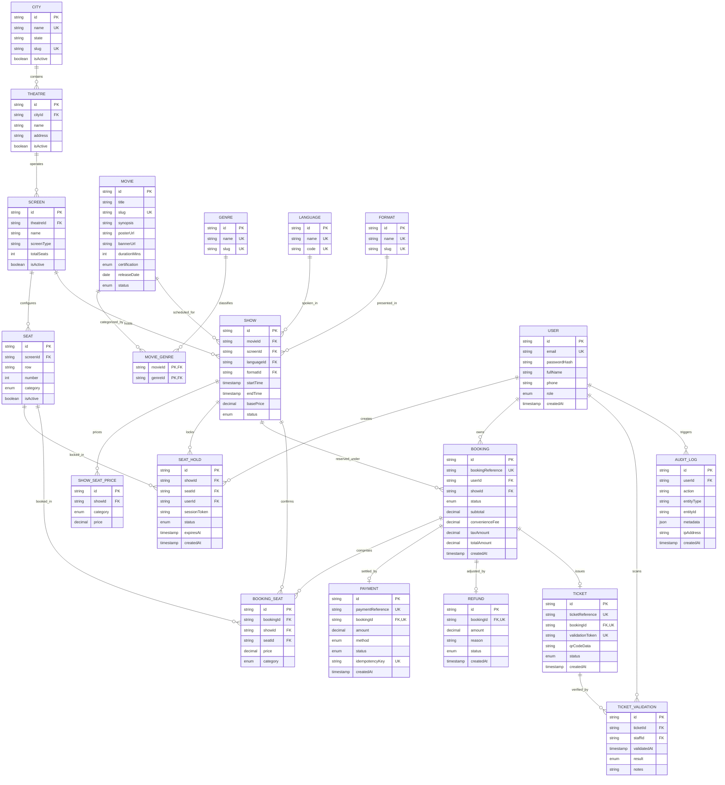

# CineHub — Database Architecture & Entity Design

**Document Version:** 1.0.0 (Stage A — Planning & Architecture)  
**Database Engine:** PostgreSQL 18  
**ORM & Migration Tool:** Prisma ORM  
**Target Environment:** Local PostgreSQL 18 & Cloud-Compatible (Supabase/Neon)  

---

## 1. Relational Schema Architecture & Design Philosophy

The CineHub database schema is designed in **Third Normal Form (3NF)** to eliminate data anomalies, ensure transactional consistency, and maintain high performance during concurrent seat reservation operations.

### Key Database Design Principles:
1. **Engine-Level Data Integrity:** Foreign keys with explicit `ON DELETE RESTRICT` or `CASCADE` rules prevent orphaned records.
2. **Concurrency Safety:** Composite unique constraints guarantee that no physical seat can be confirmed more than once for a single showtime.
3. **Audit Trail Immutability:** Audit and validation records are append-only to preserve legal and operational compliance.
4. **Optimized Query Indexing:** High-frequency access paths (e.g., showtime availability, active hold lookups, user booking history, and ticket references) are indexed with B-Tree indexes.

---

## 2. Complete Entity-Relationship (ER) Diagram



---

## 3. Detailed Entity Dictionary & Constraints

### 3.1 Core Users & Authorization

#### `User`
| Column | Type | Constraints | Description |
|---|---|---|---|
| `id` | `VARCHAR(36)` | PK, Default: UUID | Unique user identifier |
| `email` | `VARCHAR(255)` | UNIQUE, NOT NULL | User email address |
| `passwordHash` | `VARCHAR(255)` | NOT NULL | Bcrypt hash (12 salt rounds) |
| `fullName` | `VARCHAR(100)` | NOT NULL | Customer or staff full name |
| `phone` | `VARCHAR(15)` | NULLABLE | Indian mobile number (+91 format) |
| `role` | `Enum: Role` | NOT NULL, Default: `CUSTOMER` | Security role: `CUSTOMER`, `STAFF`, `ADMIN` |
| `createdAt` | `TIMESTAMP(3)` | Default: `NOW()` | Account creation timestamp |
| `updatedAt` | `TIMESTAMP(3)` | Updated: `NOW()` | Profile modification timestamp |

---

### 3.2 Cinema Infrastructure

#### `City`
| Column | Type | Constraints | Description |
|---|---|---|---|
| `id` | `VARCHAR(36)` | PK, UUID | City identifier |
| `name` | `VARCHAR(100)` | UNIQUE, NOT NULL | Display name (e.g., Mumbai, Delhi-NCR) |
| `state` | `VARCHAR(100)` | NOT NULL | State name (e.g., Maharashtra, Karnataka) |
| `slug` | `VARCHAR(100)` | UNIQUE, NOT NULL | URL-friendly slug (e.g., `mumbai`) |
| `isActive` | `BOOLEAN` | Default: `true` | Operating status |

#### `Theatre`
| Column | Type | Constraints | Description |
|---|---|---|---|
| `id` | `VARCHAR(36)` | PK, UUID | Theatre identifier |
| `cityId` | `VARCHAR(36)` | FK -> `City.id`, NOT NULL | Operating city |
| `name` | `VARCHAR(150)` | NOT NULL | Theatre name (e.g., PVR Phoenix Lower Parel) |
| `address` | `TEXT` | NOT NULL | Full physical address |
| `isActive` | `BOOLEAN` | Default: `true` | Operational status |

#### `Screen`
| Column | Type | Constraints | Description |
|---|---|---|---|
| `id` | `VARCHAR(36)` | PK, UUID | Screen/Auditorium identifier |
| `theatreId` | `VARCHAR(36)` | FK -> `Theatre.id`, Cascade | Host theatre |
| `name` | `VARCHAR(50)` | NOT NULL | Auditorium label (e.g., Audi 1, IMAX Hall) |
| `screenType` | `VARCHAR(50)` | NOT NULL, Default: `STANDARD`| `STANDARD`, `IMAX`, `4DX`, `GOLD_CLASS` |
| `totalSeats` | `INTEGER` | NOT NULL | Capacity of auditorium |
| `isActive` | `BOOLEAN` | Default: `true` | Active status |

#### `Seat`
| Column | Type | Constraints | Description |
|---|---|---|---|
| `id` | `VARCHAR(36)` | PK, UUID | Physical seat identifier |
| `screenId` | `VARCHAR(36)` | FK -> `Screen.id`, Cascade | Parent screen |
| `row` | `VARCHAR(5)` | NOT NULL | Row letter (e.g., A, B, C ... M) |
| `number` | `INTEGER` | NOT NULL | Seat index in row (e.g., 1, 2 ... 20) |
| `category` | `Enum: SeatCategory` | NOT NULL | Tier: `SILVER`, `GOLD`, `PLATINUM`, `RECLINER` |
| `isActive` | `BOOLEAN` | Default: `true` | Usable seat flag |
*Unique Constraint:* `UNIQUE(screenId, row, number)` prevents duplicate seat coordinate definitions in a single screen.

---

### 3.3 Movies & Programming

#### `Movie`
| Column | Type | Constraints | Description |
|---|---|---|---|
| `id` | `VARCHAR(36)` | PK, UUID | Movie identifier |
| `title` | `VARCHAR(200)` | NOT NULL | Movie display title |
| `slug` | `VARCHAR(200)` | UNIQUE, NOT NULL | URL slug (e.g., `kalki-2898-ad`) |
| `synopsis` | `TEXT` | NOT NULL | Comprehensive movie plot |
| `posterUrl` | `VARCHAR(500)` | NOT NULL | High-res vertical poster image URL |
| `bannerUrl` | `VARCHAR(500)` | NULLABLE | Cinematic horizontal hero backdrop URL |
| `trailerUrl` | `VARCHAR(500)` | NULLABLE | YouTube embed/trailer video link |
| `durationMins` | `INTEGER` | NOT NULL | Runtime in minutes |
| `certification` | `Enum: Certification`| NOT NULL | CBFC rating: `U`, `UA`, `A`, `S` |
| `releaseDate` | `DATE` | NOT NULL | Official release date |
| `status` | `Enum: MovieStatus` | NOT NULL, Default: `NOW_SHOWING` | `NOW_SHOWING`, `COMING_SOON`, `ARCHIVED` |

#### `Show`
| Column | Type | Constraints | Description |
|---|---|---|---|
| `id` | `VARCHAR(36)` | PK, UUID | Scheduled showtime identifier |
| `movieId` | `VARCHAR(36)` | FK -> `Movie.id`, Restrict | Feature film |
| `screenId` | `VARCHAR(36)` | FK -> `Screen.id`, Restrict | Auditorium |
| `languageId` | `VARCHAR(36)` | FK -> `Language.id` | Audio language (Hindi, English, etc.) |
| `formatId` | `VARCHAR(36)` | FK -> `Format.id` | Projection format (2D, 3D, IMAX 3D) |
| `startTime` | `TIMESTAMP(3)` | NOT NULL | Show commencement time |
| `endTime` | `TIMESTAMP(3)` | NOT NULL | Calculated finish time (start + duration + buffer) |
| `basePrice` | `DECIMAL(10,2)` | NOT NULL | Baseline ticket price (Silver tier) |
| `status` | `Enum: ShowStatus` | NOT NULL, Default: `SCHEDULED` | `SCHEDULED`, `RUNNING`, `COMPLETED`, `CANCELLED` |
*Index:* `CREATE INDEX idx_shows_lookup ON Show(movieId, screenId, startTime);`

#### `ShowSeatPrice`
| Column | Type | Constraints | Description |
|---|---|---|---|
| `id` | `VARCHAR(36)` | PK, UUID | Price override record |
| `showId` | `VARCHAR(36)` | FK -> `Show.id`, Cascade | Target show |
| `category` | `Enum: SeatCategory` | NOT NULL | Target tier (`SILVER`, `GOLD`, `PLATINUM`, `RECLINER`) |
| `price` | `DECIMAL(10,2)` | NOT NULL | Specific price in INR |
*Unique Constraint:* `UNIQUE(showId, category)` guarantees single pricing rule per tier per show.

---

### 3.4 Concurrency, Holds & Bookings

#### `SeatHold` (Critical Concurrency Table)
| Column | Type | Constraints | Description |
|---|---|---|---|
| `id` | `VARCHAR(36)` | PK, UUID | Hold session identifier |
| `showId` | `VARCHAR(36)` | FK -> `Show.id`, Cascade | Associated showtime |
| `seatId` | `VARCHAR(36)` | FK -> `Seat.id`, Cascade | Target physical seat |
| `userId` | `VARCHAR(36)` | FK -> `User.id`, Cascade | Requesting customer |
| `sessionToken`| `VARCHAR(100)` | NOT NULL | Client-side idempotency hold token |
| `status` | `Enum: HoldStatus` | Default: `ACTIVE` | `ACTIVE`, `EXPIRED`, `RELEASED`, `CONVERTED` |
| `expiresAt` | `TIMESTAMP(3)` | NOT NULL | Hard TTL boundary (`NOW() + 10 mins`) |
| `createdAt` | `TIMESTAMP(3)` | Default: `NOW()` | Hold creation time |
*Index:* `CREATE INDEX idx_seat_hold_active ON SeatHold(showId, seatId, status, expiresAt);`

#### `Booking`
| Column | Type | Constraints | Description |
|---|---|---|---|
| `id` | `VARCHAR(36)` | PK, UUID | Primary order ID |
| `bookingReference`| `VARCHAR(20)` | UNIQUE, NOT NULL | Human-readable ref (e.g., `CNH-2026-9812`) |
| `userId` | `VARCHAR(36)` | FK -> `User.id`, Restrict | Customer account |
| `showId` | `VARCHAR(36)` | FK -> `Show.id`, Restrict | Booked show |
| `status` | `Enum: BookingStatus`| Default: `PENDING` | `PENDING`, `CONFIRMED`, `CANCELLED` |
| `subtotal` | `DECIMAL(10,2)` | NOT NULL | Base sum of all tickets |
| `convenienceFee`| `DECIMAL(10,2)` | NOT NULL | Configurable platform fee (e.g., ₹30 per booking) |
| `taxAmount` | `DECIMAL(10,2)` | NOT NULL | 18% GST (9% CGST + 9% SGST) |
| `totalAmount` | `DECIMAL(10,2)` | NOT NULL | Final payable INR amount |
| `createdAt` | `TIMESTAMP(3)` | Default: `NOW()` | Order placement time |
| `updatedAt` | `TIMESTAMP(3)` | Updated: `NOW()` | State change time |

#### `BookingSeat` (Double-Booking Elimination Table)
| Column | Type | Constraints | Description |
|---|---|---|---|
| `id` | `VARCHAR(36)` | PK, UUID | Booking-Seat junction record |
| `bookingId` | `VARCHAR(36)` | FK -> `Booking.id`, Cascade | Parent order |
| `showId` | `VARCHAR(36)` | FK -> `Show.id`, Restrict | Scheduled show |
| `seatId` | `VARCHAR(36)` | FK -> `Seat.id`, Restrict | Booked physical seat |
| `price` | `DECIMAL(10,2)` | NOT NULL | Locked ticket price at booking time |
| `category` | `Enum: SeatCategory` | NOT NULL | Category at booking time |
*Unique Constraint:* `UNIQUE(showId, seatId)` — **The ultimate database-level defense.** Enforces that a seat cannot physically have two active booking records for the same show.

---

### 3.5 Payments, Tickets & Staff Validations

#### `Payment`
| Column | Type | Constraints | Description |
|---|---|---|---|
| `id` | `VARCHAR(36)` | PK, UUID | Payment record ID |
| `paymentReference`| `VARCHAR(50)` | UNIQUE, NOT NULL | Transaction reference (e.g., `PAY-SIM-8912`) |
| `bookingId` | `VARCHAR(36)` | FK -> `Booking.id`, UNIQUE | Associated booking |
| `amount` | `DECIMAL(10,2)` | NOT NULL | Debited INR amount |
| `method` | `Enum: PaymentMethod`| NOT NULL | `UPI`, `CARD`, `NETBANKING` |
| `status` | `Enum: PaymentStatus`| NOT NULL | `SUCCESS`, `FAILED`, `PENDING` |
| `idempotencyKey` | `VARCHAR(100)` | UNIQUE, NOT NULL | Client UUID preventing double payments |
| `createdAt` | `TIMESTAMP(3)` | Default: `NOW()` | Transaction timestamp |

#### `Ticket`
| Column | Type | Constraints | Description |
|---|---|---|---|
| `id` | `VARCHAR(36)` | PK, UUID | Digital ticket ID |
| `ticketReference` | `VARCHAR(30)` | UNIQUE, NOT NULL | Pass code (e.g., `TCK-8921-X9`) |
| `bookingId` | `VARCHAR(36)` | FK -> `Booking.id`, UNIQUE | Originating confirmed booking |
| `validationToken` | `VARCHAR(64)` | UNIQUE, NOT NULL | Secure high-entropy random token |
| `qrCodeData` | `TEXT` | NOT NULL | Base64 PNG QR code payload |
| `status` | `Enum: TicketStatus` | Default: `ISSUED` | `ISSUED`, `USED`, `CANCELLED` |
| `createdAt` | `TIMESTAMP(3)` | Default: `NOW()` | Issuance timestamp |

#### `TicketValidation` (Single-Use Audit Record)
| Column | Type | Constraints | Description |
|---|---|---|---|
| `id` | `VARCHAR(36)` | PK, UUID | Scan audit ID |
| `ticketId` | `VARCHAR(36)` | FK -> `Ticket.id` | Verified ticket |
| `staffId` | `VARCHAR(36)` | FK -> `User.id` | Gate staff performing scan |
| `validatedAt` | `TIMESTAMP(3)` | Default: `NOW()` | Exact time of gate check-in |
| `result` | `Enum: ValidationResult`| NOT NULL | `VALID`, `ALREADY_USED`, `INVALID`, `CANCELLED` |
| `notes` | `TEXT` | NULLABLE | Gate location / operator remarks |

#### `AuditLog`
| Column | Type | Constraints | Description |
|---|---|---|---|
| `id` | `VARCHAR(36)` | PK, UUID | Log entry ID |
| `userId` | `VARCHAR(36)` | NULLABLE | Responsible user |
| `action` | `VARCHAR(100)` | NOT NULL | Action string (`SHOW_CREATED`, `BOOKING_CANCELLED`) |
| `entityType` | `VARCHAR(50)` | NOT NULL | Entity model (`Booking`, `Movie`, `Show`) |
| `entityId` | `VARCHAR(50)` | NOT NULL | Target entity primary key |
| `metadata` | `JSONB` | NULLABLE | Detailed before/after diff or snapshot |
| `ipAddress` | `VARCHAR(45)` | NULLABLE | Origin IP address |
| `createdAt` | `TIMESTAMP(3)` | Default: `NOW()` | Immutable log creation timestamp |

---

## 4. Complete Prisma Schema Definition (`prisma/schema.prisma`)

```prisma
datasource db {
  provider = "postgresql"
  url      = env("DATABASE_URL")
}

generator client {
  provider = "prisma-client-js"
}

enum Role {
  CUSTOMER
  STAFF
  ADMIN
}

enum SeatCategory {
  SILVER
  GOLD
  PLATINUM
  RECLINER
}

enum MovieStatus {
  NOW_SHOWING
  COMING_SOON
  ARCHIVED
}

enum Certification {
  U
  UA
  A
  S
}

enum ShowStatus {
  SCHEDULED
  RUNNING
  COMPLETED
  CANCELLED
}

enum HoldStatus {
  ACTIVE
  EXPIRED
  RELEASED
  CONVERTED
}

enum BookingStatus {
  PENDING
  CONFIRMED
  CANCELLED
}

enum PaymentMethod {
  UPI
  CARD
  NETBANKING
}

enum PaymentStatus {
  PENDING
  SUCCESS
  FAILED
}

enum TicketStatus {
  ISSUED
  USED
  CANCELLED
}

enum ValidationResult {
  VALID
  ALREADY_USED
  INVALID
  CANCELLED
}

model User {
  id               String             @id @default(uuid())
  email            String             @unique
  passwordHash     String
  fullName         String
  phone            String?
  role             Role               @default(CUSTOMER)
  createdAt        DateTime           @default(now())
  updatedAt        DateTime           @updatedAt

  seatHolds        SeatHold[]
  bookings         Booking[]
  validationsDone  TicketValidation[]
  auditLogs        AuditLog[]
}

model City {
  id        String    @id @default(uuid())
  name      String    @unique
  state     String
  slug      String    @unique
  isActive  Boolean   @default(true)
  theatres  Theatre[]
}

model Theatre {
  id        String   @id @default(uuid())
  cityId    String
  city      City     @relation(fields: [cityId], references: [id], onDelete: Restrict)
  name      String
  address   String
  isActive  Boolean  @default(true)
  screens   Screen[]

  @@index([cityId])
}

model Screen {
  id         String   @id @default(uuid())
  theatreId  String
  theatre    Theatre  @relation(fields: [theatreId], references: [id], onDelete: Cascade)
  name       String
  screenType String   @default("STANDARD")
  totalSeats Int
  isActive   Boolean  @default(true)
  seats      Seat[]
  shows      Show[]

  @@index([theatreId])
}

model Seat {
  id           String        @id @default(uuid())
  screenId     String
  screen       Screen        @relation(fields: [screenId], references: [id], onDelete: Cascade)
  row          String
  number       Int
  category     SeatCategory  @default(SILVER)
  isActive     Boolean       @default(true)

  seatHolds    SeatHold[]
  bookingSeats BookingSeat[]

  @@unique([screenId, row, number])
  @@index([screenId])
}

model Genre {
  id     String       @id @default(uuid())
  name   String       @unique
  slug   String       @unique
  movies MovieGenre[]
}

model Movie {
  id            String        @id @default(uuid())
  title         String
  slug          String        @unique
  synopsis      String        @db.Text
  posterUrl     String
  bannerUrl     String?
  trailerUrl    String?
  durationMins  Int
  certification Certification @default(UA)
  releaseDate   DateTime
  status        MovieStatus   @default(NOW_SHOWING)
  createdAt     DateTime      @default(now())

  genres        MovieGenre[]
  shows         Show[]
}

model MovieGenre {
  movieId String
  genreId String
  movie   Movie  @relation(fields: [movieId], references: [id], onDelete: Cascade)
  genre   Genre  @relation(fields: [genreId], references: [id], onDelete: Cascade)

  @@id([movieId, genreId])
}

model Language {
  id    String @id @default(uuid())
  name  String @unique
  code  String @unique
  shows Show[]
}

model Format {
  id    String @id @default(uuid())
  name  String @unique
  slug  String @unique
  shows Show[]
}

model Show {
  id          String          @id @default(uuid())
  movieId     String
  movie       Movie           @relation(fields: [movieId], references: [id], onDelete: Restrict)
  screenId    String
  screen      Screen          @relation(fields: [screenId], references: [id], onDelete: Restrict)
  languageId  String
  language    Language        @relation(fields: [languageId], references: [id], onDelete: Restrict)
  formatId    String
  format      Format          @relation(fields: [formatId], references: [id], onDelete: Restrict)
  startTime   DateTime
  endTime     DateTime
  basePrice   Decimal         @db.Decimal(10, 2)
  status      ShowStatus      @default(SCHEDULED)
  createdAt   DateTime        @default(now())

  prices      ShowSeatPrice[]
  seatHolds   SeatHold[]
  bookings    Booking[]
  bookingSeats BookingSeat[]

  @@index([movieId, screenId, startTime])
  @@index([startTime])
}

model ShowSeatPrice {
  id       String       @id @default(uuid())
  showId   String
  show     Show         @relation(fields: [showId], references: [id], onDelete: Cascade)
  category SeatCategory
  price    Decimal      @db.Decimal(10, 2)

  @@unique([showId, category])
}

model SeatHold {
  id           String     @id @default(uuid())
  showId       String
  show         Show       @relation(fields: [showId], references: [id], onDelete: Cascade)
  seatId       String
  seat         Seat       @relation(fields: [seatId], references: [id], onDelete: Cascade)
  userId       String
  user         User       @relation(fields: [userId], references: [id], onDelete: Cascade)
  sessionToken String
  status       HoldStatus @default(ACTIVE)
  expiresAt    DateTime
  createdAt    DateTime   @default(now())

  @@index([showId, seatId, status, expiresAt])
  @@index([userId])
}

model Booking {
  id               String        @id @default(uuid())
  bookingReference String        @unique
  userId           String
  user             User          @relation(fields: [userId], references: [id], onDelete: Restrict)
  showId           String
  show             Show          @relation(fields: [showId], references: [id], onDelete: Restrict)
  status           BookingStatus @default(PENDING)
  subtotal         Decimal       @db.Decimal(10, 2)
  convenienceFee   Decimal       @db.Decimal(10, 2)
  taxAmount        Decimal       @db.Decimal(10, 2)
  totalAmount      Decimal       @db.Decimal(10, 2)
  createdAt        DateTime      @default(now())
  updatedAt        DateTime      @updatedAt

  bookingSeats     BookingSeat[]
  payment          Payment?
  refund           Refund?
  ticket           Ticket?

  @@index([userId])
  @@index([showId])
}

model BookingSeat {
  id        String       @id @default(uuid())
  bookingId String
  booking   Booking      @relation(fields: [bookingId], references: [id], onDelete: Cascade)
  showId    String
  show      Show         @relation(fields: [showId], references: [id], onDelete: Restrict)
  seatId    String
  seat      Seat         @relation(fields: [seatId], references: [id], onDelete: Restrict)
  price     Decimal      @db.Decimal(10, 2)
  category  SeatCategory

  @@unique([showId, seatId]) // Double-booking prevention
  @@index([bookingId])
}

model Payment {
  id               String        @id @default(uuid())
  paymentReference String        @unique
  bookingId        String        @unique
  booking          Booking       @relation(fields: [bookingId], references: [id], onDelete: Cascade)
  amount           Decimal       @db.Decimal(10, 2)
  method           PaymentMethod
  status           PaymentStatus @default(PENDING)
  idempotencyKey   String        @unique
  createdAt        DateTime      @default(now())
}

model Refund {
  id        String   @id @default(uuid())
  bookingId String   @unique
  booking   Booking  @relation(fields: [bookingId], references: [id], onDelete: Cascade)
  amount    Decimal  @db.Decimal(10, 2)
  reason    String
  status    String   @default("COMPLETED")
  createdAt DateTime @default(now())
}

model Ticket {
  id              String             @id @default(uuid())
  ticketReference String             @unique
  bookingId       String             @unique
  booking         Booking            @relation(fields: [bookingId], references: [id], onDelete: Cascade)
  validationToken String             @unique
  qrCodeData      String             @db.Text
  status          TicketStatus       @default(ISSUED)
  createdAt       DateTime           @default(now())
  updatedAt       DateTime           @updatedAt

  validations     TicketValidation[]
}

model TicketValidation {
  id          String           @id @default(uuid())
  ticketId    String
  ticket      Ticket           @relation(fields: [ticketId], references: [id], onDelete: Cascade)
  staffId     String
  staff       User             @relation(fields: [staffId], references: [id], onDelete: Restrict)
  validatedAt DateTime         @default(now())
  result      ValidationResult
  notes       String?

  @@index([ticketId])
  @@index([staffId])
}

model AuditLog {
  id         String   @id @default(uuid())
  userId     String?
  user       User?    @relation(fields: [userId], references: [id], onDelete: SetNull)
  action     String
  entityType String
  entityId   String
  metadata   Json?
  ipAddress  String?
  createdAt  DateTime @default(now())

  @@index([entityType, entityId])
  @@index([userId])
}
```

