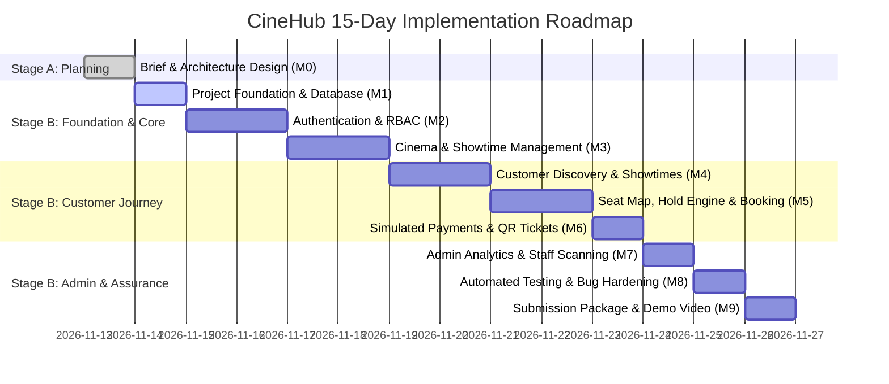

# CineHub — Master Project Plan & Execution Strategy

**Project Name:** CineHub — Full-Stack Cinema Hall Ticket Booking System  
**Organization / Evaluator:** ALGIONS AI LABS PRIVATE LIMITED  
**Assessment Type:** Advanced Individual Internship Project Assessment  
**Author / Candidate:** Full-Stack Web Development Candidate  
**Target Domain:** Cinema Hall Ticket Booking (India-focused, BookMyShow inspired)  
**Document Version:** 1.0.0 (Stage A — Planning & Architecture)  
**Date:** November 2026  

---

## 1. Executive Summary & Project Purpose

CineHub is a production-grade, database-backed cinema hall ticket booking platform engineered to mirror the real-world operational workflows, high-concurrency booking integrity, and polished user experience of leading entertainment platforms like BookMyShow.

This project is built to satisfy all specifications detailed in the **ALGIONS AI LABS PRIVATE LIMITED Assignment Brief (`docs/assignment_brief.docx`)** and the **Master Project Instruction**. It is not a cosmetic prototype or collection of mock screens; it implements real relational database persistence, server-enforced role-based authorization, pessimistic concurrency locking for seat reservation, atomic transactional ticket booking, idempotent payment simulation, single-use cryptographically verifiable QR tickets, comprehensive administrative reporting, and automated test coverage.

---

## 2. Project Scope & Functional Boundaries

### 2.1 In-Scope Deliverables

```
+--------------------------------------------------------------------------------------------------+
|                                        CINEHUB SYSTEM SCOPE                                      |
+---------------------------------+--------------------------------+-------------------------------+
|       CUSTOMER DISCOVERY        |       BOOKING & PAYMENTS       |      ADMIN & OPERATIONS       |
+---------------------------------+--------------------------------+-------------------------------+
| * Indian City Selection         | * Interactive Seat Map         | * Movie Catalog Management    |
| * Movie Browsing & Search       | * Multi-Tier Seat Pricing      | * Theatre & Screen Management |
| * Genre / Language / Format     | * 10-Min Temporary Seat Holds  | * Seat Layout Configuration   |
| * Dynamic Movie Details Page    | * Atomic Double-Booking Lock   | * Showtime Scheduling Engine  |
| * Multi-Theatre Schedules       | * Idempotent Payment Simulator | * Real-Time Occupancy Reports |
| * Date & Showtime Filtering     | * Digital QR Code Tickets      | * Financial & Sales Summaries |
| * Mobile Responsive UI          | * Booking History & Details    | * Staff QR Ticket Validator   |
| * Authentication & Profile      | * Configurable Cancellations   | * System Audit Logs           |
+---------------------------------+--------------------------------+-------------------------------+
```

1. **Multi-Role User Management:**
   - **Customer:** Public registration, profile management, movie discovery, seat selection, booking, digital ticket generation, booking history, and self-service cancellation with simulated refund.
   - **Cinema Staff:** Secure authentication, dedicated staff portal, real-time ticket search and QR code scanner, atomic entry validation, and duplicate prevention.
   - **Administrator:** Full administrative dashboard, movie catalog CRUD, theatre/screen management, seat layout generation, showtime conflict-free scheduling, tiered pricing overrides, occupancy/revenue reports, and immutable audit logs.

2. **Core Cinema Operations:**
   - Indian cinema context: Multi-city support (Mumbai, Delhi-NCR, Bengaluru, Hyderabad, Chennai, Kolkata, Pune), regional languages (Hindi, English, Tamil, Telugu, Malayalam, Punjabi), and formats (2D, 3D, IMAX 2D, IMAX 3D, 4DX).
   - Seat categories: Silver, Gold, Platinum, and Recliner with distinct visual layout markers, row labeling, and dynamic price calculations.
   - Configurable Indian tax structure: 18% GST on cinema tickets and convenience fee.

3. **High-Concurrency Seat Reservation Engine:**
   - Temporary seat hold with 10-minute countdown timer.
   - Strict database-level double-booking prevention using PostgreSQL transactions and partial unique constraints.
   - Automatic expiration and release of stale holds.
   - Atomic transition from `HELD` to `CONFIRMED` upon simulated payment completion.

4. **Security, Auditing & Quality:**
   - Bcrypt password hashing, Auth.js JWT session handling, server-side RBAC guards on all endpoints.
   - Tamper-proof digital tickets with unique alphanumeric booking references and secure QR validation payloads.
   - Comprehensive audit trail recording all business-critical actions.
   - 100% automated test verification of the 5 mandatory acceptance tests.

### 2.2 Out-of-Scope (Deliberate Architectural Boundaries)

1. **Real Payment Gateway Integration:** Real financial transactions and sensitive credit card / banking credential collection are strictly out-of-scope to protect user data and eliminate external payment merchant fees. Idempotent payment simulation (UPI, Cards, Net Banking) is provided.
2. **Third-Party Email / SMS Delivery (Twilio/SendGrid):** External paid delivery APIs are avoided to ensure zero-cost reproducibility; in-app confirmation screens, digital ticket downloads, and printable views satisfy all ticket receipt needs.
3. **Multi-Tenant Franchise Billing:** CineHub operates as a single-organization cinema booking engine.

---

## 3. Mandatory Acceptance Criteria

The system is explicitly engineered and tested to satisfy all five core acceptance tests established in Section 3 of the assignment brief:

| # | Acceptance Test | Implementation Mechanism | Verification Test Suite |
|---|---|---|---|
| **AT-1** | **Seat Hold & Booking**<br>An available seat can be held and successfully booked for a show. | 10-min `SeatHold` row creation -> dynamic state change to `HELD` -> simulated payment -> atomic transition to `Booking` + `BookingSeat` with status `CONFIRMED`. | `tests/integration/booking-flow.test.ts` |
| **AT-2** | **Double-Booking Prevention**<br>The same seat cannot be confirmed for two users for the same show. | PostgreSQL row-level locks (`SELECT ... FOR UPDATE`), transaction isolation, and composite unique constraints on `(showId, seatId)`. Second request receives `409 Conflict`. | `tests/concurrency/double-booking.test.ts` |
| **AT-3** | **Hold Expiry & Seat Retention**<br>Expired holds release the seat; confirmed bookings remain permanently unavailable. | Timestamp-based TTL evaluation (`expiresAt < NOW()`), automated lazy release on query, background sweep cron, and confirmed `BookingSeat` check. | `tests/integration/hold-expiry.test.ts` |
| **AT-4** | **Single-Use Ticket Entry**<br>A ticket reference/QR can be validated once; a second validation attempt is rejected. | Dedicated Staff portal; atomic transition `Ticket.status = USED` and insertion into `TicketValidation`. Duplicate scan triggers `409 ALREADY_USED`. | `tests/integration/ticket-validation.test.ts` |
| **AT-5** | **Occupancy & Sales Report Integrity**<br>Admin occupancy report dynamically reflects bookings and cancellations. | Real-time SQL aggregation joining `Screen.totalSeats`, confirmed `BookingSeat` count, and subtracting `CANCELLED` bookings. | `tests/integration/occupancy-report.test.ts` |

---

## 4. Evaluation Rubric Alignment (100 Marks Breakdown)

Every engineering decision is aligned with the 100-mark evaluation rubric from Section 6 of the assignment brief:

```
+---------------------------------------------------------------------------------------------------+
|                                 100-MARK EVALUATION RUBRIC MAPPING                                |
+------------------------------------+-------+------------------------------------------------------+
| Rubric Criterion                   | Marks | CineHub Implementation Evidence                      |
+------------------------------------+-------+------------------------------------------------------+
| 1. Core Workflows & Business Rules |  30   | Complete end-to-end user & staff journeys: discovery,|
|                                    |       | hold, payment, ticket generation, scanning, cancel.  |
+------------------------------------+-------+------------------------------------------------------+
| 2. Architecture, Data Model & APIs |  20   | Clean Layered Monolith, 19 normalized Prisma models, |
|                                    |       | strict FKs, OpenAPI 3.0 specs, Zod validation.       |
+------------------------------------+-------+------------------------------------------------------+
| 3. Security, Auth & Data Integrity |  15   | Auth.js RBAC, server guards, bcrypt, ACID PostgreSQL |
|                                    |       | transactions, idempotency keys, audit trails.        |
+------------------------------------+-------+------------------------------------------------------+
| 4. UI/UX & Responsive Behavior     |  10   | Cinema Red/Gold design system, interactive SVG seat   |
|                                    |       | map, mobile responsiveness, skeletons, empty states. |
+------------------------------------+-------+------------------------------------------------------+
| 5. Testing & Reliability           |  15   | Vitest unit & integration suites, concurrency tests, |
|                                    |       | Playwright E2E tests, verified test execution logs.  |
+------------------------------------+-------+------------------------------------------------------+
| 6. Documentation & Demo            |  10   | Markdown docs, ER diagram, API catalog, local run    |
|                                    |       | guide, demo accounts, 3-5 min video walkthrough.     |
+------------------------------------+-------+------------------------------------------------------+
```

---

## 5. 15-Day Milestone Roadmap & Execution Schedule

The project roadmap strictly respects the 15-calendar-day timeline suggested in Section 7 of the assignment brief, decomposed into nine actionable engineering milestones:



### Detailed Milestone Breakdown

#### Milestone 0: Requirements Analysis & Architecture (Day 1)
- Deep inspection of `docs/assignment_brief.docx` and Master Project Instruction.
- Production of Stage A planning deliverables:
  - `docs/PROJECT_PLAN.md`
  - `docs/ARCHITECTURE.md`
  - `docs/DATABASE_DESIGN.md`
  - `docs/API_DESIGN.md`
  - `docs/REQUIREMENTS_TRACEABILITY.md`
- Formal checkpoint review and authorization request.

#### Milestone 1: Project Foundation & Database Scaffold (Days 2–3)
- Initialize Next.js 15 App Router project with TypeScript strict mode.
- Configure Tailwind CSS, custom color palette (`#171923`, `#242B3A`, `#E83B50`, `#E8B86D`, `#F4F3F0`), and shadcn/ui.
- Setup Prisma ORM with PostgreSQL 18 connection.
- Define full 19-table relational schema with indexes and constraints.
- Create initial Prisma migration.
- Write robust database seed script with Indian cinema datasets:
  - 8 Indian Metros (Mumbai, Delhi-NCR, Bengaluru, Hyderabad, Chennai, Kolkata, Pune, Chandigarh).
  - 6 Indian Theatres (PVR PHOENIX Mumbai, INOX Megaplex Delhi, Cinepolis Forum Bengaluru, etc.).
  - 8 Popular Indian & Global Films (*Kalki 2898 AD*, *Jawan*, *Stree 2*, *RRR*, *Oppenheimer*, *Dune 2*, *Pushpa 2*, *Interstellar*).
  - Pre-seeded screens, tiered seat layouts (Silver, Gold, Platinum, Recliner), and multi-day showtimes.
  - Demo accounts for Customer, Admin, and Staff roles.

#### Milestone 2: Authentication & Role-Based Authorization (Days 4–5)
- Integrate Auth.js (NextAuth v5) with Credentials provider and Prisma adapter.
- Implement secure password hashing with `bcryptjs`.
- Construct server-side RBAC guards (`requireRole`, `requireAuth`).
- Build Next.js Edge Middleware for route protection (`/admin/*`, `/staff/*`, `/customer/*`).
- Create responsive UI screens for Login, Registration, and Session profile.

#### Milestone 3: Cinema & Showtime Administration (Days 6–7)
- Build Admin management APIs and dashboards:
  - Movie catalog management (Add/Edit/Archive movies, poster URL, formats, languages, duration, censor rating).
  - Theatre & Screen configuration (Audi layout generator, capacity, tier assignment).
  - Showtime scheduling engine with automated schedule conflict detection (preventing overlapping shows on the same screen).
  - Tiered ticket pricing overrides per show.

#### Milestone 4: Customer Discovery & Showtime Selection (Days 8–9)
- Build BookMyShow-style responsive customer portal:
  - Header with persistent Indian city selector, instant movie search, and user auth state.
  - Hero carousel with featured trending releases.
  - Filterable movie grid (Now Showing / Coming Soon, Genres, Languages, Formats).
  - Rich Movie Details page (Cast, crew, synopsis, trailer modal, censor rating, runtime).
  - Theatre schedule view grouped by cinema, date picker tabs, and interactive showtime badges displaying screen type and pricing.

#### Milestone 5: Booking Engine, Seat Map & Concurrency Control (Days 10–11)
- Interactive cinema seat layout component:
  - Categorized rows (Silver, Gold, Platinum, Recliner) with screen direction indicator.
  - Real-time seat statuses: Available, Selected, Held by Current User, Held by Other, Booked.
- Backend Seat Hold Engine:
  - `POST /api/shows/[id]/hold-seats` executing PostgreSQL serializable/row-level lock transaction.
  - Active hold lease generation with 10-minute countdown client timer.
  - Automatic release endpoint `POST /api/holds/[id]/release`.
  - Double-booking conflict resolution returning clean 409 error payloads.
  - Booking Summary modal with configurable GST (18%) and convenience fee breakdown.

#### Milestone 6: Simulated Payments, Digital Tickets & Staff Scanner (Days 12–13)
- Payment Simulation Engine:
  - Multi-method selector (UPI with VPA validation, Debit/Credit Card, Net Banking).
  - Idempotency key tracking preventing accidental duplicate debits.
  - Success, Failure, and Pending simulation switches.
- Atomic Booking Confirmation:
  - On payment success, atomically convert `SeatHold` to `Booking` and `BookingSeat`.
  - Generate unique booking reference (e.g., `CNH-2026-89412`).
  - Generate cryptographically verifiable QR code containing validation token.
- Staff Validation Portal:
  - Camera-based / manual entry ticket validator at `/staff/scanner`.
  - Atomic verification verifying showtime date/screen and marking ticket `USED`.
  - Duplicate check rejecting already scanned tickets with audit timestamp.
- Customer Self-Service Cancellation:
  - Configurable cancellation window (e.g., up to 2 hours before showtime).
  - Cancellation execution, seat release, and simulated refund calculation.

#### Milestone 7: Administrative Reporting & Audit Trail (Day 13)
- Admin analytics dashboard powered by Recharts:
  - Total revenue, total tickets booked, overall occupancy percentage.
  - Movie-wise performance breakdown.
  - Screen occupancy heatmaps.
  - Cancellation trends.
- Immutable Audit Log:
  - Tracking show scheduling, price changes, booking confirmations, cancellations, and staff ticket scans.

#### Milestone 8: Comprehensive QA, Test Automation & Edge-Case Hardening (Day 14)
- Vitest unit tests for pricing calculations, GST logic, and cancellation eligibility rules.
- Vitest integration tests for API endpoints and state transitions.
- Concurrency simulation test suite verifying that parallel requests to reserve the identical seat reject all but one with 409 Conflict.
- Playwright E2E customer booking journey.
- Verification and reporting against all 5 mandatory Acceptance Tests.

#### Milestone 9: Submission Package & Final Polish (Day 15)
- OpenAPI / Swagger documentation (`/docs/api`).
- Complete repository documentation: `README.md` with step-by-step setup, demo credentials, and environment configuration.
- Technical Architecture Report (`docs/TECHNICAL_REPORT.md`).
- 3–5 minute recorded video walkthrough script and demonstration checklist.
- Clean repository sanitization (verifying no secrets or `.env` files are tracked).

---

## 6. Risk Management & Mitigation Matrix

| Risk Event | Severity | Probability | Mitigation Strategy |
|---|---|---|---|
| **Concurrent Seat Race Condition** | Critical | Medium | PostgreSQL transactions with `SELECT ... FOR UPDATE`, composite database constraints on `(showId, seatId)`, and atomic confirmation. |
| **Orphaned / Stale Seat Holds** | High | High | Explicit 10-minute TTL timestamp; background cleanup schedule plus opportunistic lazy-expiry filtering during seat availability queries. |
| **Duplicate Payment Submissions** | High | Medium | Client-generated UUID `Idempotency-Key` stored in `Payment` table; duplicate requests return existing transaction status. |
| **Staff Ticket Replay / Counterfeit** | High | Low | High-entropy alphanumeric validation tokens hashed and stored in database; atomic state transition to `USED` with single-record constraint. |
| **Schedule Overlap on Screens** | Medium | Medium | Database exclusion query validating `startTime` and `endTime` against existing screen schedules before show creation. |
| **Port / Service Dependency Lock** | Low | Low | Fully self-contained Next.js monolithic deployment with standard PostgreSQL connection string; zero external paid dependencies. |

---

## 7. Demo Account Credentials (Pre-Seeded)

For reviewer evaluation and automated testing, the database will be seeded with standard, easily testable demo credentials:

| Role | Email | Password | Access Scope |
|---|---|---|---|
| **Administrator** | `admin@cinehub.in` | `Admin@1234` | Full access to `/admin` dashboard, movie/theatre/screen/show CRUD, reports, audit logs. |
| **Cinema Staff** | `staff@cinehub.in` | `Staff@1234` | Access to `/staff` ticket scanner, verification logs, and screen status. |
| **Customer 1** | `rajesh@example.com` | `Customer@1234` | Standard customer account with active bookings and history. |
| **Customer 2** | `priya@example.com` | `Customer@1234` | Secondary customer account used for concurrency conflict demonstration. |

---

## 8. Definition of Done (DoD)

A feature or milestone is considered complete ONLY when:
1. Complete TypeScript code compiles with zero errors under `strict: true`.
2. Database schema migrations apply cleanly and seed scripts execute without warning.
3. Server-side authorization protects the endpoint from privilege escalation.
4. UI displays loading skeleton, error message, empty state, and responsive layout.
5. Unit or integration test covering the happy path and negative path is passing.
6. The feature satisfies the corresponding item in `docs/REQUIREMENTS_TRACEABILITY.md`.

